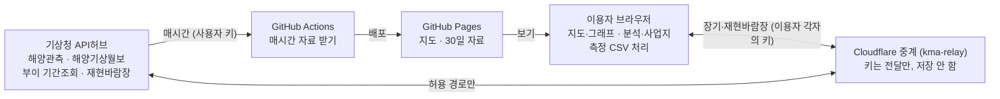

# 해양 바람·파랑 관측 대시보드 — 구성·운영 정리

2026-11-09 기준

## 개요

기상청 해양관측(해양기상부이·파고부이·등표 등 197개 지점)을 지도에 실시간으로 보여 주고, 장기 자료 다운로드와 풍황·파랑 분석까지 하는 공개 웹사이트입니다. 설치나 로그인 없이 주소만 있으면 누구나 씁니다.

| 항목 | 내용 |
| --- | --- |
| 사이트 | [i2sea.github.io/marine-weather-dashboard](https://i2sea.github.io/marine-weather-dashboard/) |
| 코드 저장소 | [github.com/i2sea/marine-weather-dashboard](https://github.com/i2sea/marine-weather-dashboard) (공개) |
| 중계 서버 | kma-relay.kyeongjin-je.workers.dev (Cloudflare Workers) |
| 자료 출처 | [기상청 API허브](https://apihub.kma.go.kr) |
| 갱신 | 매시간 자동 (GitHub Actions) |

## 기능

지도·그래프는 누구나 바로 쓰고, 장기 다운로드와 재현바람장은 이용자가 자기 기상청 API허브 키를 넣고 씁니다.

| 기능 | 내용 | 키 필요 |
| --- | --- | --- |
| 실시간 지도 | 해양기상부이·파고부이·등표·조위·연안방재·기상1호 197개 지점, 풍향 화살표·풍속·유의파고 표시 | 없음 |
| 지점 그래프 | 최신값 6개, 최근 1·3·7·30일 풍속·돌풍·파고·수온·기온 | 없음 |
| 최근 30일 CSV | 사이트에 보관된 1시간 자료를 바로 내려받기 | 없음 |
| 1·5·10년 CSV | 해양기상부이 30분 원자료, 등표·파고부이 일자료 | 이용자 키 |
| 재현바람장 | 지도 빈 곳을 눌러 그 위치의 10·80·140·220m 바람 (2021.6~2026.5, 1km 격자) | 이용자 키 |
| 허브높이 환산 | 허브높이 직접 입력(예: 137m), 지수·로그법칙, 풍속계 높이 자동(없으면 추정 표시), 그래프·CSV 반영 | 없음 |
| 분석 — 풍황 요약 | 평균풍속, 와이블 k·c, 바람장미, 풍속 빈도, 월별 평균, 회수율 | 없음 |
| 분석 — 파랑 요약 | 유의파고 빈도·초과확률·월별, 파고–주기 결합빈도, 파향 장미, 검벨 극치 | 없음 |
| 분석 — 설계파(간이) | 극치 또는 직접 입력 H1/3 → Hmax, 주기, 파장, 쇄파 한계 | 없음 |
| 분석 — 작업 가능일 | 파고·풍속 기준 + 연속 시간, 월별 가능일(결측 보정 포함) | 없음 |
| 분석 — 장기 보정(MCP) | 직접 측정 자료와 장기 자료의 선형 회귀(전체·12방위), 장기 추정 시계열 | 없음 |
| 측정 CSV 올리기 | 시각·풍속·풍향·파고·파주기·파향 열 자동 인식, 브라우저 안에서만 처리 | 없음 |
| 사업지 경계 | KML·GeoJSON·좌표로 구역 표시, 가까운 관측소 12곳 거리, 중심점 재현바람장 | 없음 |
| 화면 | 휴대폰 배치, 모든 패널에 돌아가기·닫기 | — |

## 시스템 구성

지도와 최근 30일 자료는 GitHub Actions가 매시간 사용자 키로 받아 GitHub Pages에 올리고, 1·5·10년 자료와 재현바람장은 이용자가 누를 때 Cloudflare 중계를 거쳐 그 이용자의 키로 받습니다. 기상청 API는 웹페이지에서 직접 부르는 것을 막아 두어 중계가 필요합니다.

| 파일 (저장소) | 역할 |
| --- | --- |
| `web/index.html`, `web/analysis.js` | 지도·그래프·다운로드·분석 화면 |
| `collector/build_site.py` | 매시간 자료를 받아 사이트 만들기 |
| `collector/marine_collector.py` | 기상청 API 수집기 (명령줄) |
| `collector/marine_dashboard.py` | PC용 대시보드 (긴 기간 다운로드) |
| `worker/kma-relay.js` | Cloudflare 중계 서버 코드 |
| `.github/workflows/update.yml` | 매시 17분 실행·배포 |

## 자료 출처와 기상청 API

모든 자료는 기상청 API허브에서 받으며, API마다 따로 활용신청해야 합니다(무료, 신청 즉시 사용). 실제 응답 형식은 2026-11-06~09에 직접 받아 확인했습니다.

| 쓰임 | API (API허브 분류) | 주소 | 확인한 제약 |
| --- | --- | --- | --- |
| 지도·30일 자료 | 해양기상종합관측 (해양관측) | `typ01/url/sea_obs.php` | 한 번에 한 시각, 전 지점. 칸: 종류·시각·지점·경도·위도·파고·풍향·풍속·돌풍·수온·기온·기압·습도 |
| 부이 1·5·10년 | 해양기상부이(기간조회) | `typ01/url/kma_buoy2.php` | 30분 간격, 19칸(품질검사 2칸 포함). 7일 단위로 요청 |
| 등표·파고부이 장기 | 해양기상월보 일별(부이·등표·파고부이) | `typ02/openApi/SeaMtlyInfoService/getDaily…` | 월 단위, 일자료. 값에 `0.2>` `x` 같은 표시 문자 |
| 풍속계 높이 | 해양기상월보 지점일람표(부이·등표) | `typ02/openApi/SeaMtlyInfoService/get…LstTbl` | 25개 지점만 높이 등록, 나머지는 0 |
| 재현바람장 | 융합기상 › 에너지 지원 › 재현바람장 위·경도 추출 | `typ01/cgi-bin/url/nph-rawm_latlon_api` | 한 번에 최대 144개 시각, 호출당 약 10초. 동시 4개면 30초에서 잘려 일부만 옴 |

설명 페이지: [해양관측 API 목록](https://apihub.kma.go.kr/apiList.do?seqApi=3&seqApiSub=249) · [융합기상 › 에너지 지원](https://apihub.kma.go.kr/apiList.do?seqApi=971&seqApiSub=983)

## 운영·관리

평소에는 손댈 일이 없고, 아래 경우에만 확인하면 됩니다.

| 상황 | 할 일 |
| --- | --- |
| 지도 갱신이 멈춘 것 같음 (상단 갱신 시각이 오래됨) | 저장소 **Actions** 탭에서 빨간 X 확인 → 로그의 오류 문구 확인. 수동 실행: Actions → 해양기상 자료 갱신 → Run workflow |
| 기상청 키를 바꿈 | 저장소 Settings → Secrets and variables → Actions → `KMA_API_KEY` 값 교체 |
| 중계 서버 코드를 바꿈 | Cloudflare → Workers 및 Pages → kma-relay → 코드 편집 → [새 코드](https://raw.githubusercontent.com/i2sea/marine-weather-dashboard/main/worker/kma-relay.js) 붙여 넣기 → 배포 |
| 중계 서버 상태 확인 | kma-relay.kyeongjin-je.workers.dev 접속 → "기상청 API 중계 서버입니다" 문구 확인 |
| 기상청이 재현바람장 기간을 늘림 | 사이트의 날짜 범위(2021-06-01~2026-05-31) 수정 필요 |

키 사용량: 지도 갱신은 사용자 키로 하루 약 100번 호출합니다. 장기·재현바람장 다운로드는 이용자 각자의 키로 나가서 사용자 키와 무관합니다. 중계 서버는 키를 저장하지 않고, 다운로드에 필요한 경로만 허용합니다.

## 다른 이용자 안내

지도·그래프·최근 30일 다운로드·분석은 키 없이 쓸 수 있고, 장기 자료와 재현바람장만 자기 키가 필요합니다.

1. [기상청 API허브](https://apihub.kma.go.kr)에 가입하고 로그인합니다.
2. 필요한 API를 **API 활용신청**합니다 (활용 분야 예: 에너지/광업). 신청 양식은 팝업으로 열리므로 팝업 차단을 풀어 주세요.
   - 해양기상부이 장기: 해양기상부이(기간조회)
   - 등표·파고부이 장기: 해양기상월보 › 일별(등표)·일별(파고부이) 기상자료
   - 재현바람장: 융합기상 › 에너지 지원 › 3.2 재현바람장 위·경도 추출 조회
3. 마이페이지의 인증키를 사이트의 노란 **내 기상청 API허브 인증키** 상자에 붙여 넣습니다. "이 브라우저에 키 기억하기"를 체크하면 다음부터 생략됩니다.

버튼이 안 눌리면 대개 API허브 로그인이 풀린 경우입니다. "활용신청이 필요한 API" 오류가 나오면 해당 API 신청이 빠진 것입니다.

## 한계와 주의사항

사이트의 분석은 풍황·해황을 빨리 훑어보는 참고용이며, 설계·인허가 제출값을 대신하지 않습니다.

- **설계파(간이)**: 관측소 위치의 몇 년치 관측으로 낸 값입니다. 큰 태풍이 빠지면 작게 나오고, 10년 미만 자료의 100년 값은 오차가 큽니다. 기초 설계에는 해양수산부 심해설계파와 사업지까지 천해 변형(굴절·천수) 검토 결과를 쓰고, 그 값을 "설계 H1/3 직접" 칸에 넣어 Hmax·파장·쇄파 한계를 확인하는 용도로 씁니다.
- **천해 변형 없음**: 수심에 따른 파장과 쇄파 한계만 계산하고, 굴절·천수·회절은 반영하지 않습니다.
- **허브높이 환산**: 지수·로그법칙 같이 환산이라 대기 안정도에 따라 실제와 다를 수 있습니다. 풍속계 높이가 일람표에 없는 지점은 같은 종류 중앙값을 "추정"으로 표시합니다.
- **장기 보정(MCP)**: 선형 회귀 방식만 있습니다. R² 0.6 미만이면 경고를 띄웁니다. 정식 풍황 평가에서는 방법·기간을 따로 검토해야 합니다.
- **일자료**: 등표·파고부이 장기 자료는 일평균이라 와이블·최대값이 실제보다 작게 나오고, 작업 가능일은 계산하지 않습니다.
- **재현바람장**: 2021.6.1~2026.5.31만 제공되며, 기상청 서버가 느려 1년치 고도 하나에 5~10분, 5년치는 30분~1시간 걸립니다. 받는 동안 창을 열어 두어야 합니다.
- **원자료**: 관측 원자료라 품질검사 전 값이 섞일 수 있습니다. 부이 장기 자료의 품질검사(AQC·MQC) 칸을 함께 보세요.
- **분석 보관함**: 브라우저 안에만 있어 새로고침하면 지워집니다. 사업지 경계·키는 이 브라우저에 저장됩니다.

## 검증 기록

실제 기상청 자료와 정답을 아는 모의 자료로 주요 기능을 확인했습니다 (2026-11-06~09).

| 항목 | 방법 | 결과 |
| --- | --- | --- |
| 지도 갱신 | GitHub Actions 실제 실행 | 721시간 전부 수신, 197개 지점 |
| 부이 장기 받기 | 실제(거제도 22104, 1월) | 30분 간격 1,486행, 결측 2개 |
| 등표·파고부이 일자료 | 실제(오륙도 984, 기장 22511, 2025-09) | 각 30일 정상 |
| 재현바람장 | 실제(35.16N 129.30E, 80·140m, 2025-06 첫 주) | 168시간 빠짐없이, 28초 |
| 와이블 추정 | 모의(정답 k=2, c=8, 8,760개) | k=2.00, c=8.02 |
| 장기 보정(MCP) | 모의(정답 1.3x+0.5) | 1.296x+0.52, R² 0.985 |
| 허브높이 환산 | 손계산 비교 | 4.3m에서 4.2m/s → 140m 6.16m/s (α 0.11) |
| 작업 가능일 결측 | 모의(매년 2월 1~3일 제거) | 자료 있는 날 25.5 / 달력 28.5 / 회수율 89% |
| 설계파 | 손계산 비교 (H1/3 7.5m, 수심 25m) | Hmax 13.5m, 파장 112.7m, 쇄파 한계 14.15m |

확인 중 발견해 고친 것: 재현바람장을 동시에 여러 개 요청하면 기상청이 30초에서 자르고 일부만 돌려줌 → 3일·동시 2개 + 이어받기로 변경. 등표 일자료 `tw_` 칸은 최고수온이 아니라 평균 습도로 정정.
